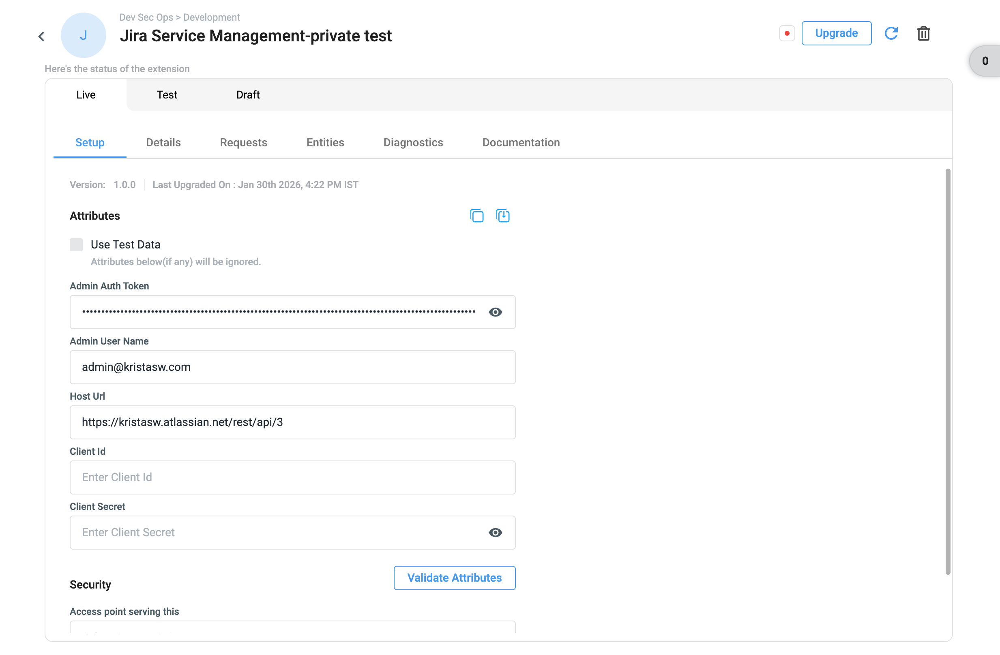
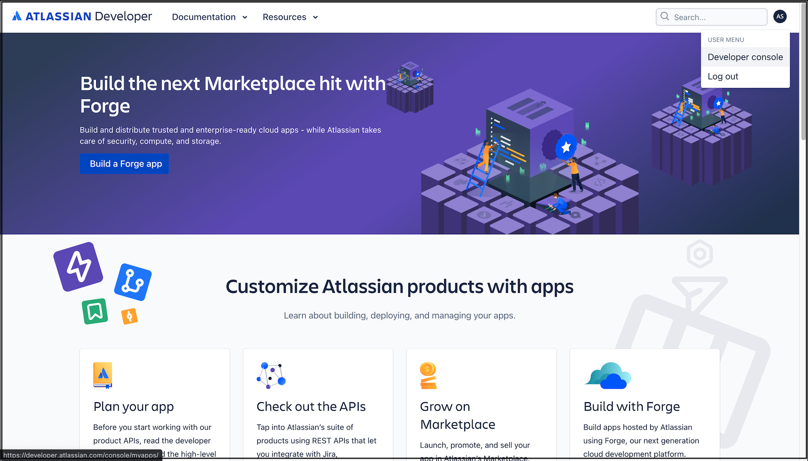
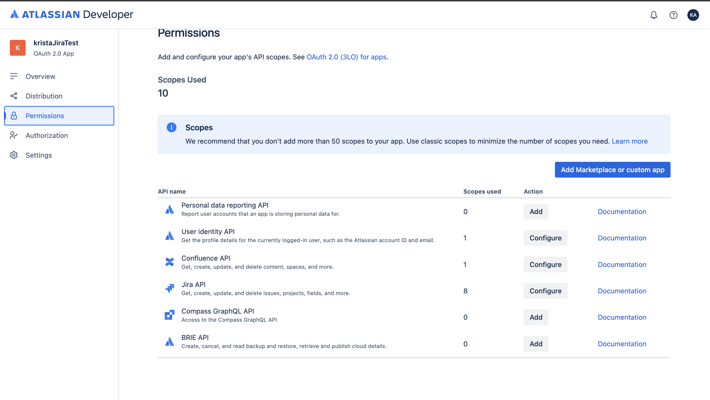
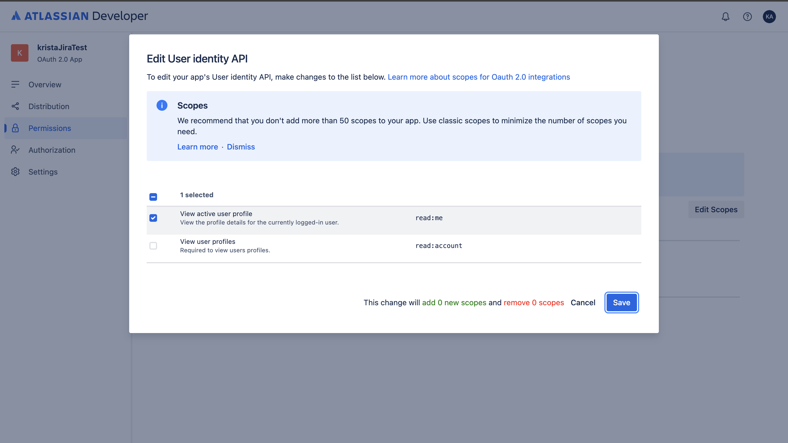
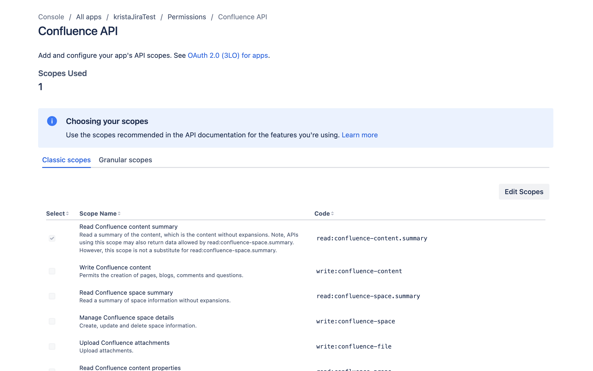
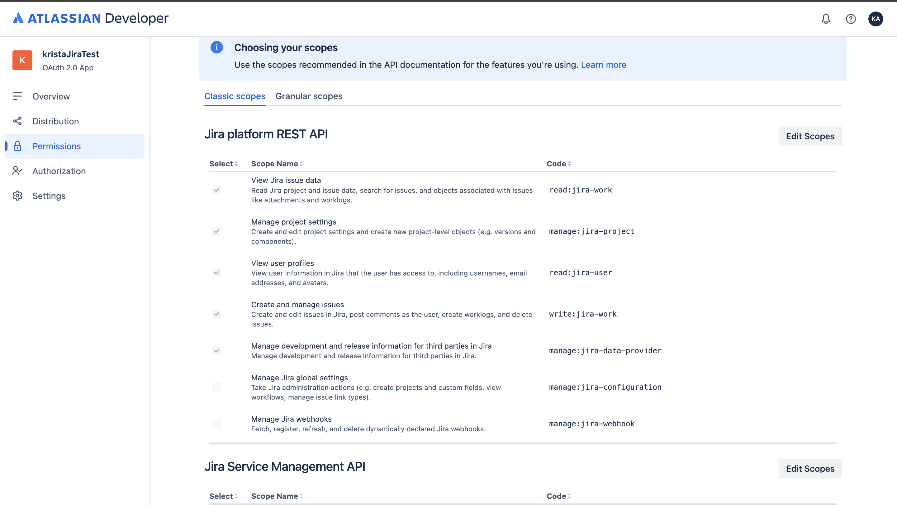
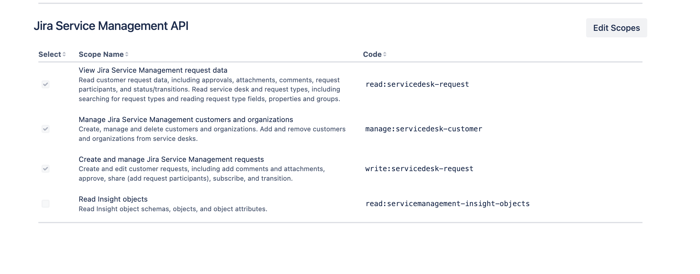
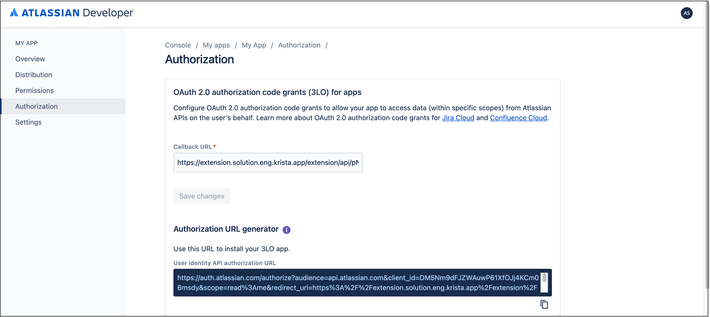
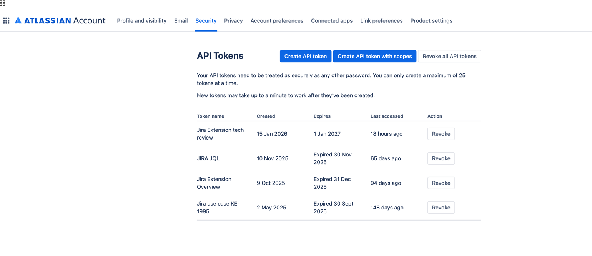
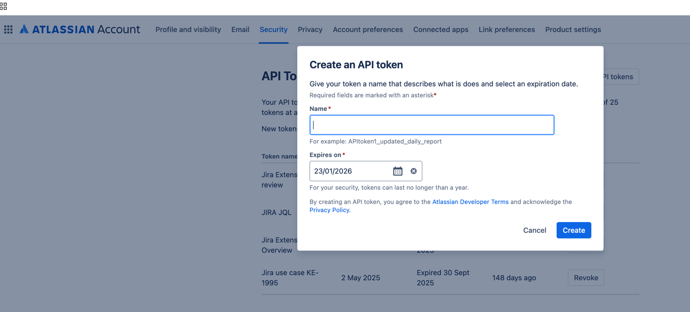

# Authentication Guide

## Overview

The JIRA Service Management Extension supports two authentication methods: OAuth 2.0 and API Token authentication. This
guide provides comprehensive setup instructions for both methods.

*Overview of supported authentication methods*

## Authentication Methods Comparison

| Feature              | OAuth 2.0                       | API Token                 |
|----------------------|---------------------------------|---------------------------|
| **Security**         | High (token-based with refresh) | Medium (long-lived token) |
| **Setup Complexity** | Complex (requires JIRA app)     | Simple (generate token)   |
| **User Experience**  | Seamless (automatic refresh)    | Manual token management   |
| **Recommended For**  | Production environments         | Development and testing   |
| **Token Expiration** | Automatic refresh               | Manual renewal required   |
| **Permissions**      | Granular scopes                 | Full user permissions     |

## OAuth 2.0 Authentication (Recommended)

OAuth 2.0 provides secure, token-based authentication with automatic token refresh capabilities. This method is
recommended for production environments.

### Prerequisites

- JIRA administrator access
- Ability to create JIRA applications
- Valid callback URL configuration

### Step 1: Create JIRA Application

1. **Access Developer Console**
    - Go to https://developer.atlassian.com/console/myapps/
    - Sign in with your Atlassian account
    - Click "Create" → "OAuth 2.0 integration"

*Atlassian Developer Console interface*

2. **Configure Application Details**
    - **App Name**: Enter descriptive name (e.g., "Krista JIRA Integration")
    - **Description**: Brief description of the integration
    - **Privacy Policy URL**: Your organization's privacy policy
    - **Terms of Service URL**: Your organization's terms of service

3. **Set Permissions and Scopes**
   Required scopes for full functionality:
    - Next, click on Permissions tab. You will see that there are different API names.
      .
    - On the Edit User Identity API panel, click Edit Scopes and select `View active user profile`. Click Save.
      .
    - Next, go to Confluence API section. Here we must select the `Read Confluence content summary` scope. Click Save.
      .
    - Lastly, go to Jira API. Select the following scopes in Jira platform REST API and Jira Service Management API-
    - `read:jira-work` - Read issues, projects, and work data
    - `write:jira-work` - Create and update issues
    - `manage:jira-project` - Project management operations
    - `read:jira-user` - Read user information
    - `manage:jira-data-provider` - Manage development and release information for third parties in Jira
    - `read:servicedesk-request` - View Jira Service Management request data
    - `write:servicedesk-request` - Create and manage Jira Service Management requests
    - `manage:servicedesk-customer` - Manage Jira Service Management customers and organizations
      .

      .
    - click save.

### Step 2: Configure OAuth Settings

1. **Authorization Callback URL**
    - Add your Krista callback URL
    - Format: `https://your-krista-instance.com/oauth/callback`
    - Ensure URL is accessible and properly configured

*OAuth callback URL configuration*

2. **Get Client Credentials**
    - **Client ID**: Copy the generated client ID
    - **Client Secret**: Copy the client secret (store securely)
    - These credentials will be used in extension configuration

### Step 3: Configure Extension

1. **Access Extension Configuration**
    - Navigate to Krista extension management
    - Select JIRA Service Management Extension
    - Choose "OAuth 2.0" authentication method

2. **Enter OAuth Credentials**
    - **JIRA Instance URL**: Your JIRA URL (e.g., https://your-domain.atlassian.net)
    - **Client ID**: From JIRA application configuration
    - **Client Secret**: From JIRA application configuration
    - **Callback URL**: Must match JIRA app configuration

3. **Authorize Connection**
    - Click "Authorize" button
    - Complete OAuth flow in popup window
    - Grant requested permissions
    - Verify successful authorization

### OAuth 2.0 Troubleshooting

#### Common Issues

**Problem: "Invalid client credentials"**

- Verify Client ID and Client Secret are correct
- Check for extra spaces or characters
- Ensure JIRA app is active and not disabled

**Problem: "Callback URL mismatch"**

- Verify callback URL matches exactly in both systems
- Check for trailing slashes or protocol differences
- Ensure URL is accessible from JIRA

**Problem: "Insufficient permissions"**

- Review granted scopes in JIRA app
- Ensure all required permissions are selected
- Re-authorize if permissions were changed

## API Token Authentication

API Token authentication uses a personal access token for authentication. This method is simpler to set up but requires
manual token management.

### Prerequisites

- JIRA user account with appropriate permissions
- Access to JIRA account settings

### Step 1: Generate API Token

1. **Access Account Settings**
    - Go to your JIRA instance
    - Click your profile picture → "Account settings"
    - Navigate to "Security" tab

*JIRA account settings interface*

2. **Create API Token**
    - Click "Create API token"
    - Enter descriptive label (e.g., "Krista Integration")
    - Copy the generated token immediately
    - Store token securely (it won't be shown again)

*API token generation process*

### Step 2: Configure Extension

1. **Access Extension Configuration**
    - Navigate to Krista extension management
    - Select JIRA Service Management Extension
    - Choose "API Token" authentication method

2. **Enter API Token Credentials**
    - **JIRA Instance URL**: Your JIRA URL (e.g., https://your-domain.atlassian.net)
    - **Username/Email**: Your JIRA account email
    - **API Token**: The generated token from Step 1

3. **Test Connection**
    - Click "Test Connection" to verify credentials
    - Ensure successful authentication
    - Save configuration if test passes

### API Token Management

#### Token Security Best Practices

1. **Secure Storage**
    - Store tokens in secure password managers
    - Never commit tokens to version control
    - Use environment variables for token storage
    - Limit token access to authorized personnel

2. **Regular Rotation**
    - Set calendar reminders for token renewal
    - Rotate tokens every 90 days minimum
    - Update all systems using the token
    - Revoke old tokens after replacement

3. **Access Monitoring**
    - Monitor token usage in JIRA audit logs
    - Review API access patterns regularly
    - Investigate unusual activity immediately
    - Maintain token usage documentation

#### Token Troubleshooting

**Problem: "Invalid API token"**

- Verify token was copied completely
- Check for extra spaces or characters
- Ensure token hasn't expired or been revoked
- Generate new token if necessary

**Problem: "Authentication failed"**

- Verify username/email is correct
- Check if account is active and not suspended
- Ensure account has necessary JIRA permissions
- Test credentials directly with JIRA API

## Security Considerations

### OAuth 2.0 Security

1. **Token Management**
    - Tokens are automatically refreshed
    - Short-lived access tokens (1 hour)
    - Secure token storage in Krista
    - Automatic token revocation on logout

2. **Permission Scoping**
    - Granular permission control
    - Principle of least privilege
    - Regular permission audits
    - Scope-based access restrictions

### API Token Security

1. **Token Lifecycle**
    - Long-lived tokens (no automatic expiration)
    - Manual token rotation required
    - Secure token transmission
    - Immediate revocation capability

2. **Access Control**
    - Full user permissions granted
    - Cannot restrict specific operations
    - Account-level access control
    - Regular access reviews required

## Migration Between Methods

### From API Token to OAuth 2.0

1. **Prepare OAuth Setup**
    - Create JIRA application
    - Configure OAuth credentials
    - Test OAuth authentication

2. **Switch Authentication Method**
    - Update extension configuration
    - Change to OAuth 2.0 method
    - Complete authorization flow
    - Verify functionality

3. **Cleanup**
    - Revoke old API token
    - Update documentation
    - Notify team of changes

### From OAuth 2.0 to API Token

1. **Generate API Token**
    - Create new API token
    - Store token securely
    - Test token functionality

2. **Update Configuration**
    - Change authentication method
    - Enter API token credentials
    - Test connection

3. **Cleanup**
    - Revoke OAuth application access
    - Archive OAuth credentials
    - Update procedures

## Monitoring and Maintenance

### Regular Tasks

1. **Weekly**
    - Monitor authentication success rates
    - Review error logs for auth issues
    - Check token expiration alerts

2. **Monthly**
    - Review user access and permissions
    - Audit authentication methods
    - Update security documentation

3. **Quarterly**
    - Rotate API tokens
    - Review OAuth application permissions
    - Conduct security assessments

### Troubleshooting Resources

- [Troubleshooting Guide](pages/Troubleshooting.md) - Comprehensive issue resolution
- [Extension Configuration](pages/ExtensionConfiguration.md) - Setup and configuration
- Atlassian OAuth 2.0 documentation
- JIRA API authentication guides

## See Also

- [Extension Configuration](pages/ExtensionConfiguration.md) - Complete setup guide
- [Troubleshooting Guide](pages/Troubleshooting.md) - Authentication issue resolution
- [Getting OAuth2.0 Credentials](pages/GettingOAuth2Credentials.md) - Detailed OAuth setup
- [Getting Basic Auth Credentials](pages/GettingBasicAuthCredentials.md) - API token setup
