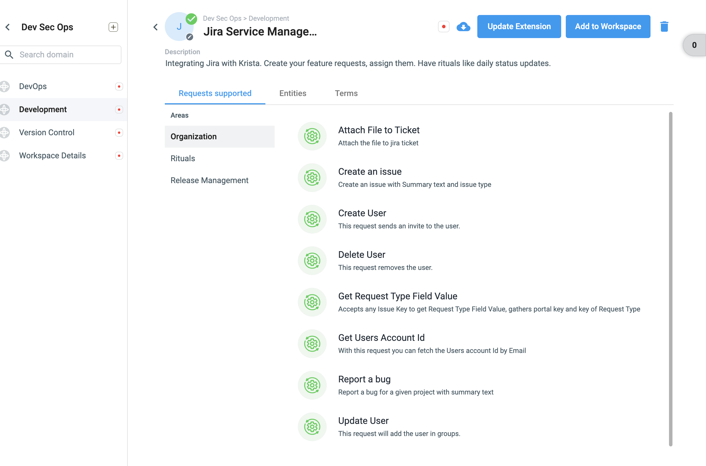
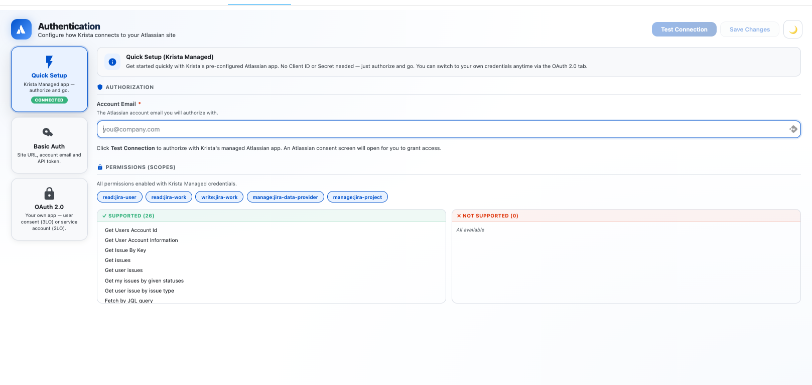
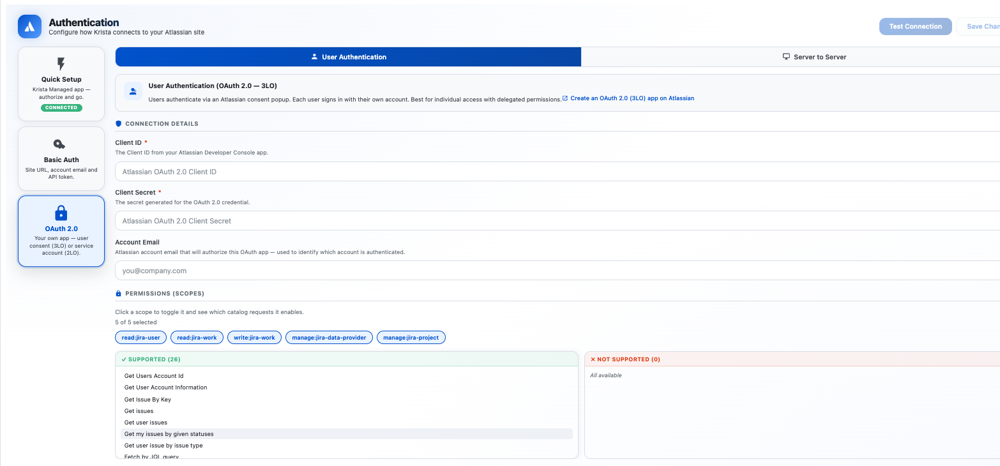
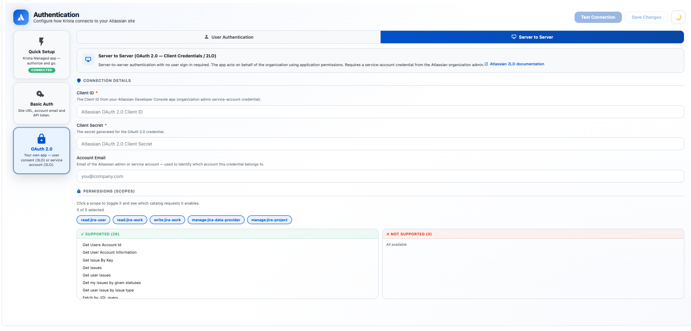
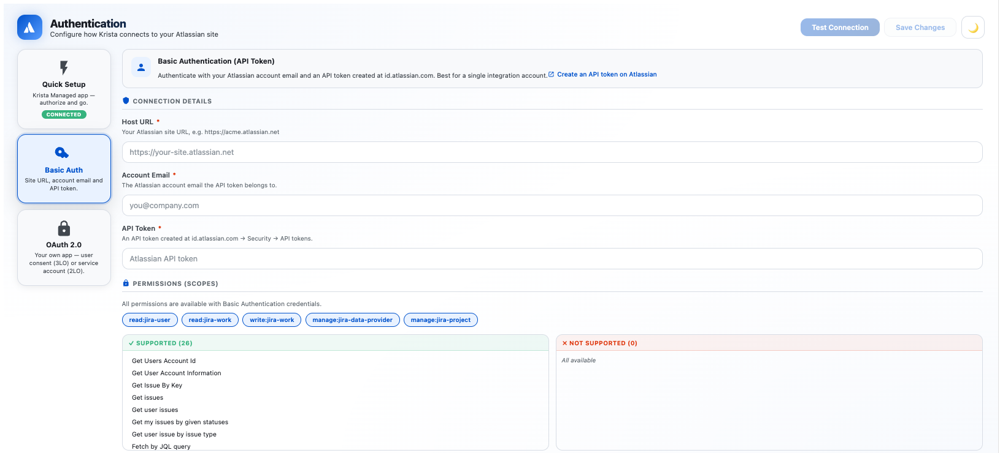

# Extension Configuration

## Overview

This guide covers the setup and configuration of the JIRA Service Management Extension in Krista.

## Prerequisites

**For OAuth 2.0 (User Authentication or Server to Server):**
- JIRA administrator access
- Atlassian Developer Console access

**For Basic Auth:**
- JIRA user account with appropriate permissions

**For Both:**
- Active Krista workspace
- Network connectivity between Krista and JIRA

---

## Quick Start

### Step 1: Install Extension

1. In Krista workspace, go to **Catalogs** → **Dev Sec Ops** → **Development**
2. Find "JIRA Service Management" and click **Add to workspace**

3. Wait for installation to complete

### Step 2: Choose Authentication Method

The extension's **Authentication** tab offers four options:

| Option | When to Use |
|--------|-------------|
| **Quick Setup** | Fastest setup — uses Krista's shared Atlassian app, no configuration needed |
| **OAuth 2.0 — User Authentication** | Your own Atlassian app, each user authenticates individually |
| **OAuth 2.0 — Server to Server** | Your own Atlassian app, app-only authentication without user sign-in |
| **Basic Auth** | Simple API token authentication |

**Important:** For OAuth 2.0, choose either **User Authentication** or **Server to Server** — do not provide both OAuth and Basic Auth credentials at the same time.

---

## Quick Setup Configuration

The simplest way to get started. Uses Krista's pre-registered Atlassian OAuth 2.0 app — no Atlassian Developer Console setup required.

### Configure in Krista

1. Go to the extension's **Authentication** tab
2. Select **Quick Setup** from the left sidebar
3. Click **Test Connection** — a Jira sign-in popup opens
4. Sign in with your Atlassian account and grant the requested permissions
5. After the popup closes, click **Save Changes**

---

## OAuth 2.0 — User Authentication Configuration

For detailed OAuth app creation steps, see [Getting OAuth 2.0 Credentials](pages/GettingOAuth2Credentials.md).

### Configure in Krista

1. Go to the extension's **Authentication** tab
2. Select **OAuth 2.0** from the left sidebar
3. Click the **User Authentication** sub-tab
4. Enter your credentials:
   - **Client ID**: From your Atlassian Developer Console app
   - **Client Secret**: From your Atlassian Developer Console app
5. Toggle the required scopes in the **Permissions (Scopes)** panel
6. Click **Test Connection** — a sign-in popup opens
7. Sign in and grant consent, then click **Save Changes**

> **Credential Validation**
>
> The extension validates that you provide credentials for **ONE authentication method only**.
>
> **You will receive an error if you:**
> - Provide both OAuth 2.0 AND Basic Auth credentials
> - Provide incomplete credentials (e.g., Client ID without Client Secret)
>
> **To fix:** Remove all credentials for the authentication method you're NOT using.

---

## OAuth 2.0 — Server to Server Configuration

App-only authentication — no user sign-in required. Requires a service-account credential from the Atlassian organization admin.

### Configure in Krista

1. Go to the extension's **Authentication** tab
2. Select **OAuth 2.0** from the left sidebar
3. Click the **Server to Server** sub-tab
4. Enter your credentials:
   - **Client ID**: Organization admin service-account Client ID
   - **Client Secret**: Organization admin service-account Client Secret
   - **Account Email**: Email of the Atlassian admin or service account
5. Click **Test Connection** — validates directly (no popup)
6. Click **Save Changes**

---

## Basic Auth Configuration

For detailed API token generation steps, see [Getting Basic Auth Credentials](pages/GettingBasicAuthCredentials.md).

### Configure in Krista

1. Go to the extension's **Authentication** tab
2. Select **Basic Auth** from the left sidebar
3. Enter your credentials:
   - **Host URL**: `https://your-domain.atlassian.net`
   - **User Name**: Your JIRA account email
   - **Auth Token**: Your Atlassian API token
4. Click **Test Connection** — validates directly (no popup)
5. Click **Save Changes**

---

## Common Validation Errors

### Error: "Please choose ONE authentication method"

**Cause:** No credentials provided, or incomplete credentials.

**Solution:**
- For OAuth 2.0: Provide both Client ID and Client Secret
- For Basic Auth: Provide all three fields (Host URL, User Name, Auth Token)

---

### Error: "Do not mix credentials from both authentication methods"

**Cause:** You provided credentials for BOTH OAuth 2.0 AND Basic Auth.

**Solution:**
- Choose which authentication method you want to use
- Remove ALL credentials for the other method

---

### Error: "Incomplete OAuth 2.0 credentials detected"

**Cause:** You provided only Client ID or only Client Secret.

**Solution:** Provide BOTH Client ID and Client Secret.

---

### Error: "Incomplete Basic Auth credentials detected"

**Cause:** You provided only 1 or 2 of the 3 required Basic Auth fields.

**Solution:** Provide ALL three fields: Host URL, User Name, and Auth Token.

---

## Testing Your Configuration

1. After entering credentials, click **Test Connection**
2. Verify successful authentication
3. Test basic functionality:
   - Create a test issue
   - Search for issues
   - Update an issue

---

## See Also

- [Authentication Guide](pages/Authentication.md) - Detailed credential setup instructions
- [Troubleshooting Guide](pages/Troubleshooting.md) - Additional issue resolution
- [Supported Requests](pages/SupportedRequests.md) - Available JIRA operations
