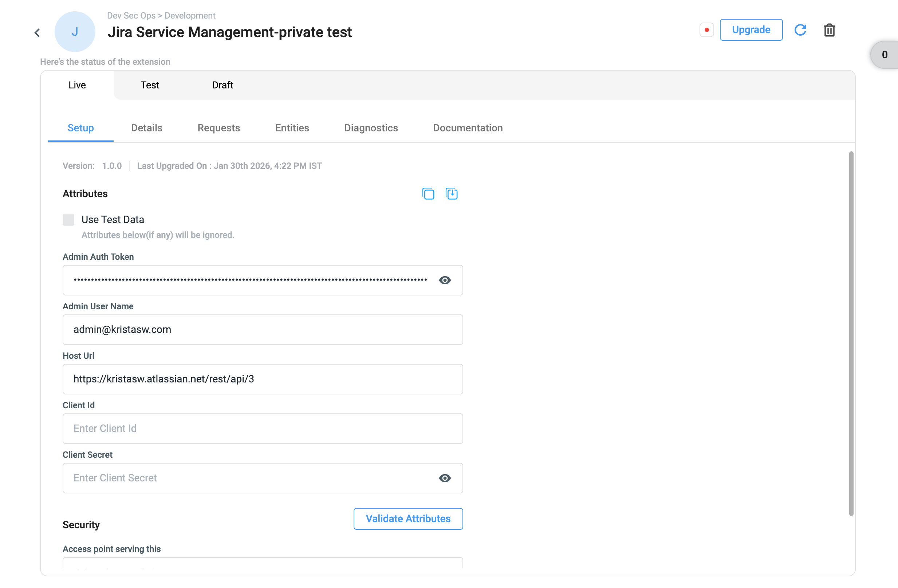
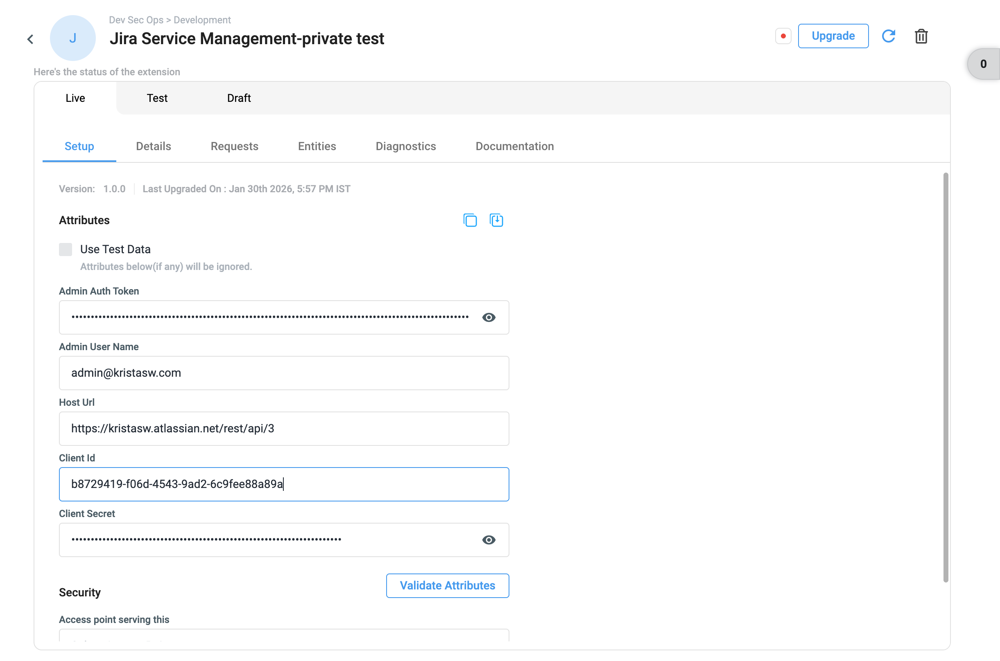

# Extension Configuration

## Overview

This comprehensive guide walks you through the complete setup and configuration of the JIRA Service Management
Extension, from initial installation to advanced configuration options.

*JIRA Extension configuration workflow*

## Prerequisites

Before configuring the JIRA extension, ensure you have:

### JIRA Requirements

- **JIRA Access**: Active JIRA Cloud or Server instance (version 8.0+)
- **Administrator Permissions**: JIRA administrator access for OAuth app creation
- **Project Access**: Access to projects you want to integrate
- **User Permissions**: Appropriate permissions for intended operations

### Krista Requirements

- **Krista Workspace**: Active Krista workspace with extension management access
- **Extension Permissions**: Ability to install and configure extensions
- **Network Access**: Connectivity between Krista and JIRA instances

### Technical Requirements

- **HTTPS**: Both Krista and JIRA must use HTTPS for OAuth 2.0
- **Network Connectivity**: Firewall rules allowing communication
- **Browser Support**: Modern browser for OAuth authorization flow

## Installation Process

### Step 1: Install Extension

1. **Access Extension Marketplace**
    - Navigate to Krista workspace
    - Go to Catalogs → Dev Sec Ops > Development
    - Search for "JIRA Service Management"

2. **Install Extension**
    - Click "Add to workspace" on the JIRA extension
    - Review permissions and requirements
    - Wait for installation completion


*Extension installation process*

### Step 2: Initial Configuration

1. **Access Configuration**
    - Go to Extensions → Installed Extensions
    - Find JIRA Service Management Extension
    - Click "Setup"

2. **Choose Authentication Method**
    - **OAuth 2.0** (Recommended for production)
    - **API Token** (Simpler for development/testing)

## OAuth 2.0 Configuration (Recommended)

OAuth 2.0 provides secure, token-based authentication with automatic refresh capabilities.

### Step 1: Create JIRA Application

1. **Access Atlassian Developer Console**
    - Go to https://developer.atlassian.com/console/myapps/
    - Sign in with Atlassian account
    - Click "Create" → "OAuth 2.0 integration"

2. **Configure Application**
    - **Name**: "Krista JIRA Integration"
    - **Description**: "Integration between Krista and JIRA"
    - **Privacy Policy**: Your organization's privacy policy URL
    - **Terms of Service**: Your organization's terms of service URL

3. **Set Required Permissions**
   ```
   ✅ read:jira-work - Read issues and projects
   ✅ write:jira-work - Create and update issues
   ✅ manage:jira-project - Project management
   ✅ read:jira-user - Read user information
   ✅ write:jira-user - User management
   ```

### Step 2: Configure Callback URL

1. **Add Callback URL**
    - In JIRA app settings, add callback URL
    - Format: `https://your-krista-instance.com/oauth/jira/callback`
    - Ensure URL is accessible and matches exactly

2. **Get Credentials**
    - Copy **Client ID**
    - Copy **Client Secret** (store securely)
    - Note these for extension configuration

### Step 3: Configure Extension

1. **Enter JIRA Details**
    - **JIRA Instance URL**: `https://your-domain.atlassian.net/rest/api/3`
    - **Authentication Method**: Select "OAuth 2.0"

2. **Enter OAuth Credentials**
    - **Client ID**: From JIRA application
    - **Client Secret**: From JIRA application
    - **Callback URL**: Must match JIRA app configuration

3. **Authorize Connection**
    - Click "Validate Attributes" button
    - Complete OAuth flow in popup
    - Grant all requested permissions
    - Verify successful authorization


*OAuth 2.0 configuration interface*

## API Token Configuration

API Token authentication is simpler but requires manual token management.

### Step 1: Generate API Token

1. **Access JIRA Account Settings**
    - Go to your JIRA instance
    - Click profile → "Account settings"
    - Navigate to "Security" tab

2. **Create API Token**
    - Click "Create API token"
    - Label: "Krista Integration"
    - Copy token immediately (won't be shown again)
    - Store token securely

### Step 2: Configure Extension

1. **Enter JIRA Details**
    - **JIRA Instance URL**: `https://your-domain.atlassian.net/rest/api/3`
    - **Authentication Method**: Select "API Token"

2. **Enter Credentials**
    - **Username/Email**: Your JIRA account email
    - **API Token**: Generated token from Step 1

3. **Test Connection**
    - Click "Test Connection"
    - Verify successful authentication
    - Save configuration if test passes


*API Token configuration interface*

## Advanced Configuration Options

### Webhook Configuration

Enable real-time notifications for JIRA issue changes.

1. **Enable Webhooks**
    - In extension configuration, enable webhook support
    - Note the webhook URL provided by Krista

2. **Configure JIRA Webhook**
    - Go to JIRA → Settings → System → Webhooks
    - Create new webhook with Krista URL
    - Select relevant events (issue created, updated, deleted)

3. **Test Webhook**
    - Create or update a test issue
    - Verify webhook notifications are received
    - Check webhook logs for any errors

### Performance Settings

Optimize extension performance for your environment.

1. **Query Limits**
    - **Default Page Size**: 20 (recommended: 20-50)
    - **Maximum Results**: 1000 (adjust based on needs)
    - **Query Timeout**: 60 seconds

2. **Caching Settings**
    - **Cache Duration**: 5 minutes (for user/project data)
    - **Cache Size**: 100 entries
    - **Auto-refresh**: Enable for frequently accessed data

3. **Rate Limiting**
    - **Requests per Minute**: 100 (adjust based on JIRA limits)
    - **Burst Limit**: 10 concurrent requests
    - **Retry Strategy**: Exponential backoff

### Security Settings

Configure security options for your organization.

1. **Access Control**
    - **Allowed Domains**: Restrict to organization domains
    - **User Restrictions**: Limit to specific user groups
    - **Project Filters**: Restrict access to specific projects

2. **Audit Logging**
    - **Enable Audit Logs**: Track all extension activities
    - **Log Retention**: 90 days (adjust based on policy)
    - **Log Level**: INFO (DEBUG for troubleshooting)

3. **Data Protection**
    - **Encrypt Tokens**: Enable token encryption at rest
    - **Secure Transmission**: Enforce HTTPS for all communications
    - **Data Retention**: Configure data cleanup policies

## Validation and Testing

### Connection Testing

1. **Basic Connectivity**
    - Test JIRA instance accessibility
    - Verify authentication credentials
    - Check network connectivity

2. **Permission Validation**
    - Test issue creation permissions
    - Verify project access rights
    - Check user management permissions

3. **Functionality Testing**
    - Create a test issue
    - Update issue properties
    - Search for issues
    - Test file attachments

### Performance Testing

1. **Query Performance**
    - Test with various query complexities
    - Measure response times
    - Verify timeout handling

2. **Load Testing**
    - Test with multiple concurrent users
    - Verify rate limiting behavior
    - Check system stability

3. **Error Handling**
    - Test with invalid inputs
    - Verify error messages are user-friendly
    - Check retry mechanisms

## Configuration Validation

### Pre-Production Checklist

- [ ] Authentication method configured and tested
- [ ] All required permissions granted
- [ ] Connection test passes successfully
- [ ] Webhook configuration tested (if enabled)
- [ ] Performance settings optimized
- [ ] Security settings configured
- [ ] Audit logging enabled
- [ ] Documentation updated
- [ ] Team training completed
- [ ] Backup/recovery procedures documented

### Post-Configuration Tasks

1. **User Training**
    - Provide training on extension features
    - Document common workflows
    - Create user guides and tutorials

2. **Monitoring Setup**
    - Configure monitoring alerts
    - Set up performance dashboards
    - Establish maintenance procedures

3. **Documentation**
    - Document configuration settings
    - Create troubleshooting guides
    - Maintain change logs

## Maintenance and Updates

### Regular Maintenance Tasks

1. **Weekly**
    - Monitor authentication success rates
    - Review error logs
    - Check performance metrics

2. **Monthly**
    - Review and rotate API tokens (if used)
    - Update documentation
    - Audit user permissions

3. **Quarterly**
    - Review security settings
    - Update extension if new versions available
    - Conduct performance reviews

### Update Procedures

1. **Before Updates**
    - Backup current configuration
    - Review release notes
    - Plan maintenance window

2. **During Updates**
    - Follow update procedures
    - Test functionality after update
    - Verify configuration settings

3. **After Updates**
    - Update documentation
    - Notify users of changes
    - Monitor for issues

## Troubleshooting Common Issues

### Configuration Problems

**Problem: Cannot save configuration**

- Verify all required fields are completed
- Check field format requirements
- Ensure network connectivity

**Problem: Authentication fails**

- Verify credentials are correct
- Check JIRA instance URL
- Test credentials directly in JIRA

**Problem: Permission errors**

- Verify user has required JIRA permissions
- Check OAuth scope configuration
- Contact JIRA administrator

### Performance Issues

**Problem: Slow response times**

- Check network connectivity
- Verify JIRA server performance
- Optimize query parameters

**Problem: Timeout errors**

- Increase timeout settings
- Simplify complex queries
- Check server resources

## Getting Help

### Self-Service Resources

- [Authentication Guide](pages/Authentication.md) - Detailed authentication setup
- [Troubleshooting Guide](pages/Troubleshooting.md) - Common issue resolution
- Extension documentation and user guides

### Support Channels

- Krista support portal
- Community forums
- Technical documentation
- Video tutorials and webinars

### Escalation Process

1. Self-service troubleshooting
2. Community support forums
3. Krista technical support
4. Engineering team escalation

## See Also

- [Authentication Guide](pages/Authentication.md) - OAuth 2.0 and API token setup
- [Troubleshooting Guide](pages/Troubleshooting.md) - Issue resolution
- [Webhook Configuration](pages/WebhookConfiguration.md) - Real-time notifications
- Individual catalog request documentation for specific features
