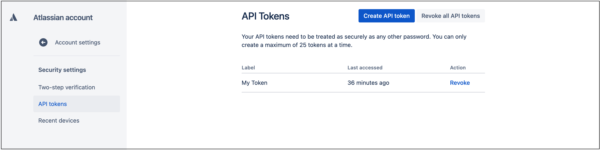
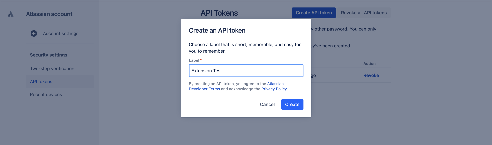

# Getting Basic Auth Credentials

### Steps to get Admin Token

* Open your Atlassian Settings Page.
* Go to the **Security** tab and click on **Create and manage API tokens**.
  
* Click Create API Token and provide a **Label**. Your API Token is generated.
  
* Copy the API Token and store it someplace safe (You will only be able to see it once).
* For more details, you can go to this [link](https://support.atlassian.com/atlassian-account/docs/manage-api-tokens-for-your-atlassian-account/).
* Your Jira app is now configured and can be used to connect with the Jira Extension in Krista.
  