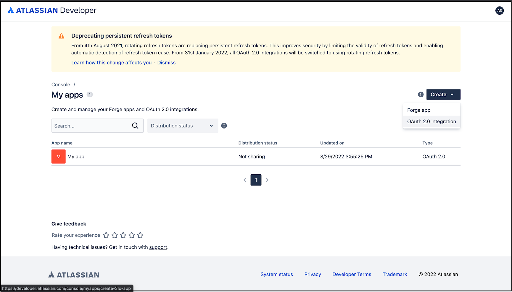
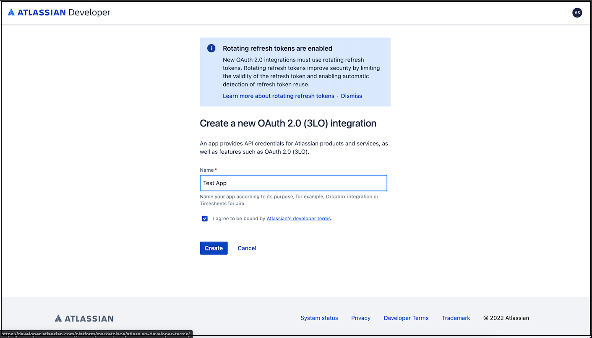
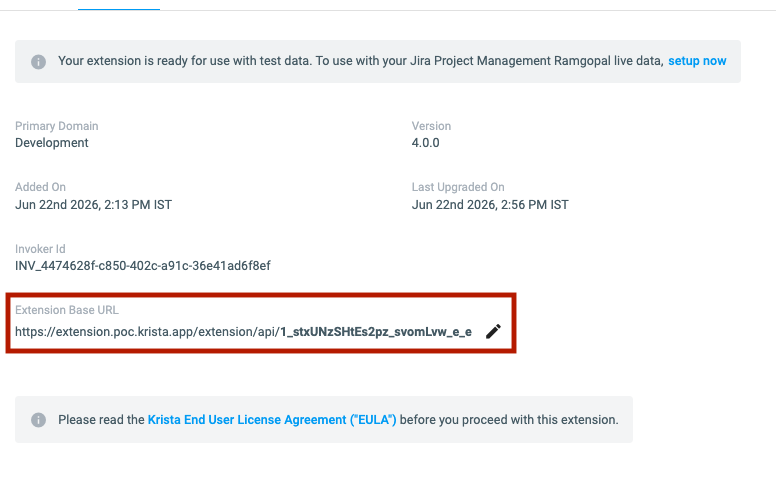
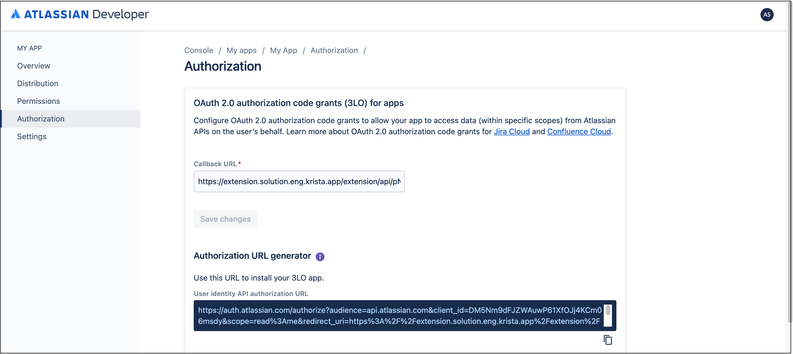
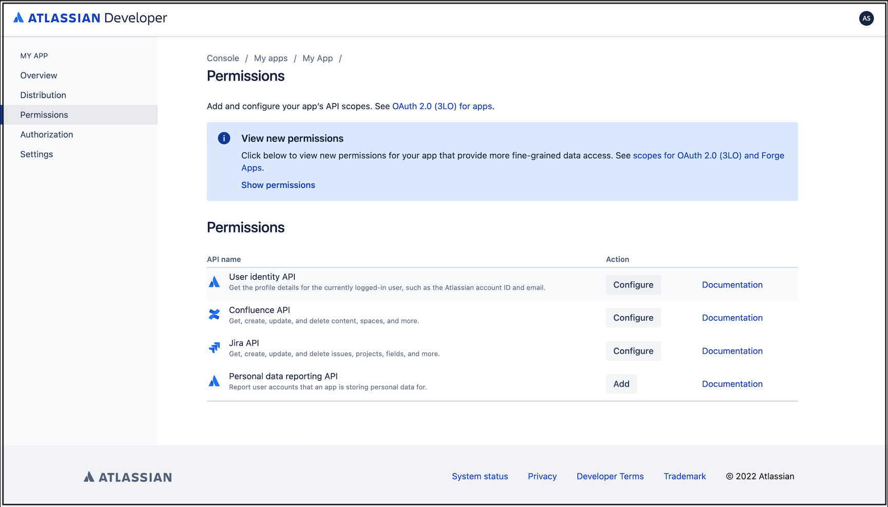
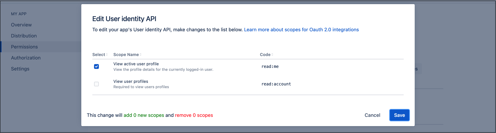
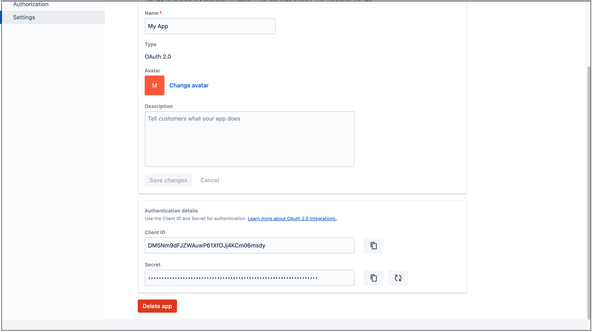

# Getting OAuth2.0 Credentials

### Steps to get Client ID and Client Secret

* Go to the Jira Developer Console from your developer home page. [Click Here](https://developer.atlassian.com/)
  
  

* Click on Create -> OAuth 2.0 Integration. A popup window will be displayed.
  
  

* Give a name for your new app. Then click Create, and your app will be created.
  

* Go to **Authorization** Tab. Click **Configure**. For the Callback URL, use your **Extension Base URL** (found on the extension's details page in Krista) with `/jiraextn/callback` appended:

  **Format:**
  ```
  {Extension Base URL}/jiraextn/callback
  ```

  **Example:**
  ```
  https://extension.poc.krista.app/extension/api/1_stxUNzSHtEs2pz_svomLvw_e_e/jiraextn/callback
  ```

  To find your Extension Base URL, go to the extension's details page in Krista:

  

  Click **Save changes**.

  

* Next, click on **Permissions** tab. You will see that there are different API names.
  
    * On the Edit User Identity API panel, click Edit Scopes and select `View active user profile`. Click `Save`.
      
    * Lastly, go to Jira API. Select the following scopes in Jira platform REST API and Jira Service Management API-
        * `View Jira issue data`
        * `Manage project settings`
        * `View user profiles`
        * `Create and manage issues`
        * `Manage development and release information for third parties in Jira`
        * `View Jira Service Management request data`

* Go to **Settings** tab. On the bottom portion of the page under Authentication details you will see that your Client ID and Client Secret are present.
  

* Your Jira Service Management app is now configured and can be used to connect with the JSM Extension in Krista.
