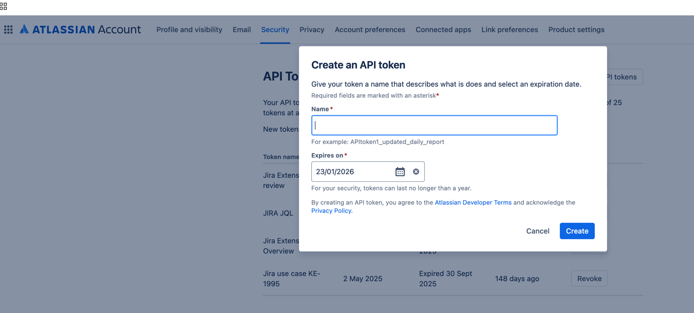
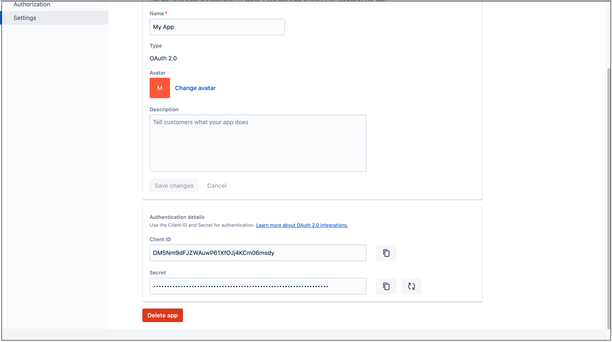
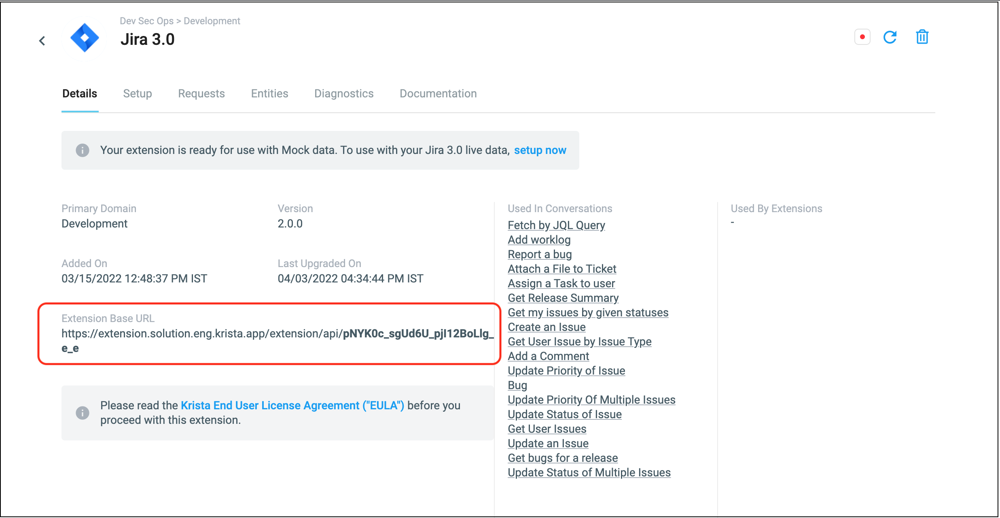
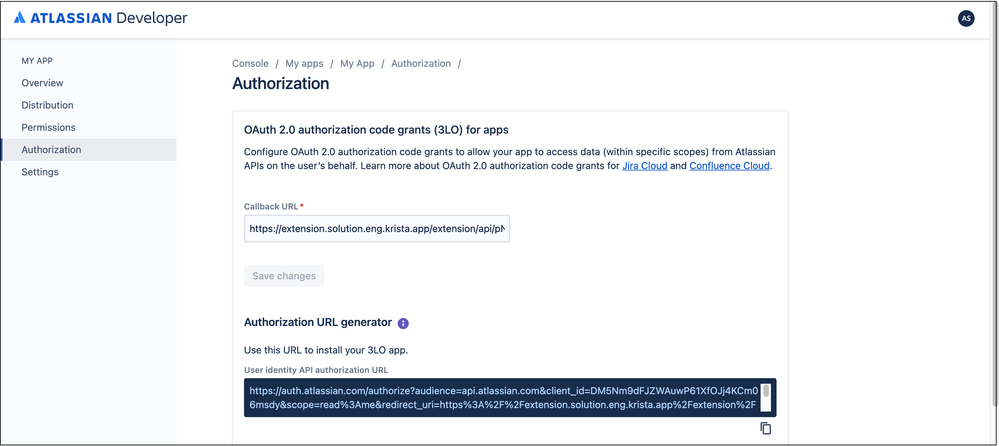

# Setting Up Jira Extension

### Steps for connection

There are two ways to connect with Jira and authenticate your application.

1. Basic Auth
    * For Basic Auth connection go to Setup and in attributes you must provide Host URL, Admin Username and Admin Auth
      Token:
        * The username is the email address with which you have created your Jira account.
        * Host URL is the URL of your Jira domain + the rest endpoint. For example, your domain URL is
          `https://your-domain.atlassian.net`, then the host url will be `https://your-domain.atlassian.net/rest/api/3`.
        * The last attribute needed for Basic Auth is the Admin/API token which you can obtain from API Token tab in
          your Atlassian Settings page.
          

2. OAuth 2.0
    * For OAuth connection go to Setup and in attributes you must provide Client ID and Client Secret:
        * To establish a connection, you must provide Client ID and Client Secret in setup parameters from your
          registered web application in Jira developer console. You can get these parameters from **Authentication
          details** tab in **Settings** page of your registered app.
          

    * Once you have provided the Client ID and Client Secret you must authorize yourself with the same account which is
      used to register the application in Jira developer console.

    * To authorize yourself, follow these steps:
        * Go to the Details page of the extension and copy the Routing ID from there.
          
        * After that, append "/jiraextn/callback" at the end of the routing ID (This is you Redirect URI). Now add this
          uri in the CallBack Uri under Authorization tab of your registered app in Jira developer console.

          
        * Go to the setup page, fill Client ID and Client Secret, save changes and upgrade the extension. Now click on
          `Test Connection`, an authentication window will be displayed. Assign the permissions using the same account
          which was used to register your application in Jira developer console.
        * After this, click on Test Connection again to verify the authentication. The message
          `Connection Tested Successfully` should be displayed.

    * After the connection is established, you are good to go with executing the requests of the extension.