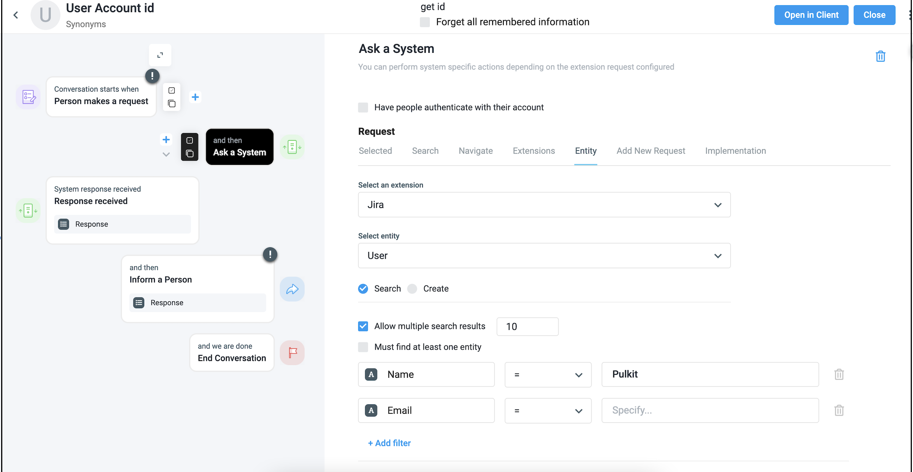
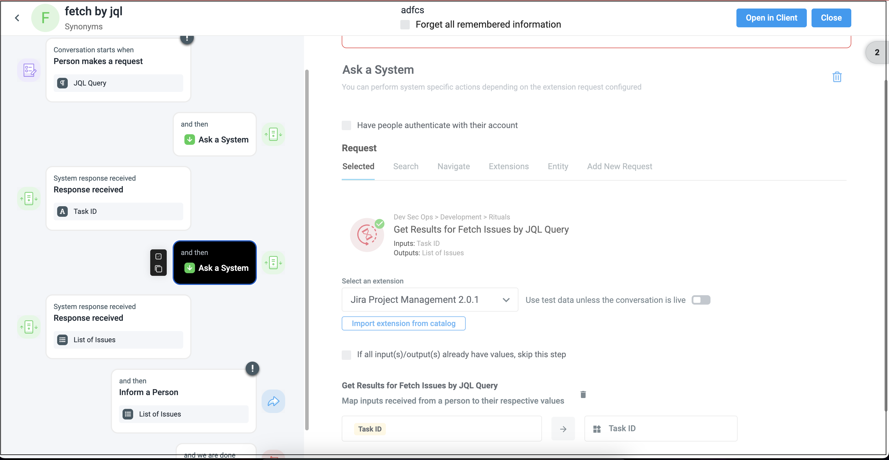

# Supported Requests

## Catalog Requests

> **Error Handling Note :**
> - If a user makes a mistake when entering data, the system will give them a chance to fix it. An error message will
    pop up, and the user can re-enter the information for that specific field. If they enter valid data the second time,
    everything will work as expected. However, if they enter invalid data again, the system will encounter a problem and
    display a more specific error message.

* ### Attach File to Ticket
    * With this request you can upload a file to a Jira ticket.
    * Inputs: Ticket ID, File
    * Output: Upload Status

| **Input Parameter Name** | **Input Parameter Type** | **Mandatory** | **Example** |
|--------------------------|--------------------------|---------------|-------------|
| Ticket ID                | Identifier               | Yes           | KC-1232     |
| File                     | File                     | Yes           | Demo.xlsx   |

* Validation for fields :

| Input Parameter | Valid Data               | Invalid Data                                                              |
|-----------------|--------------------------|---------------------------------------------------------------------------|
| Ticket ID       | Upload Status As Success | The remediation action will be received, and the data will be re-entered. |

* ### Assign Issue to epic
    * This request assigns a given issue to a given epic.
    * Inputs: Issue key, Epic key

| **Input Parameter Name** | **Input Parameter Type** | **Mandatory** | **Example** |
|--------------------------|--------------------------|---------------|-------------|
| Issue Key                | Text                     | Yes           | KC-1231     |
| Epic Key                 | Text                     | Yes           | KC-1232     |

* Validation for Issue key and Epic Key :

| Input Parameter | Valid Data | Invalid Data                                                              |
|-----------------|------------|---------------------------------------------------------------------------|
| Issue Key       | Success    | The remediation action will be received, and the data will be re-entered. |
| Epic Key        | Success    | The remediation action will be received, and the data will be re-entered. |

* ### Assign Child Issue to epic
    * This request assigns a given subtask to a given epic.
    * Inputs: Child Issue Key, Parent Epic key
    * Output: Is Successful switch

| **Input Parameter Name** | **Input Parameter Type** | **Mandatory** | **Example** |
|--------------------------|--------------------------|---------------|-------------|
| Child Issue Key          | Text                     | Yes           | KC-1231     |
| Parent Epic key          | Text                     | Yes           | KC-1232     |

* Validation for fields :

| Input Parameter | Valid Data | Invalid Data                                                             |
|-----------------|------------|--------------------------------------------------------------------------|
| Child Issue Key | Success    | The remediation action will be received, and the data will be re-entered |
| Parent Epic key | Success    | The remediation action will be received, and the data will be re-entered |

* ### Create an Issue
    * This request creates an issue by issue type.
    * Inputs: Project Key, Summary, Issue Type
    * Output: New Issue

| **Input Parameter Name** | **Input Parameter Type** | **Mandatory** | **Example** |
|--------------------------|--------------------------|---------------|-------------|
| Project Key              | Text                     | Yes           | KC          |
| Summary                  | Text                     | Yes           | Summary     |
| Issue Type               | Text                     | Yes           | Story       |

* Validation for fields :

| Input Parameter | Valid Data | Invalid Data                                                             |
|-----------------|------------|--------------------------------------------------------------------------|
| Project Key     | Success    | The remediation action will be received, and the data will be re-entered |
| Summary         | Success    | The remediation action will be received, and the data will be re-entered |
| Issue Type      | Success    | The remediation action will be received, and the data will be re-entered |

* ### Report a Bug
    * This request reports a bug.
    * Inputs: Project Key, Summary
    * Output: New Bug

| **Input Parameter Name** | **Input Parameter Type** | **Mandatory** | **Example** |
|--------------------------|--------------------------|---------------|-------------|
| Project Key              | Text                     | Yes           | KC          |
| Summary                  | Text                     | Yes           | Summary     |

* Validation for fields :

| Input Parameter | Valid Data | Invalid Data                                                             |
|-----------------|------------|--------------------------------------------------------------------------|
| Project Key     | Success    | The remediation action will be received, and the data will be re-entered |
| Summary         | Success    | The remediation action will be received, and the data will be re-entered |

* ### Get My Issues By Given Statuses
    * This request obtains issues by given statuses.
    * Input: Status Names List
    * Output: List of Issues

| **Input Parameter Name** | **Input Parameter Type** | **Mandatory** | **Example** |
|--------------------------|--------------------------|---------------|-------------|
| Status Names             | List of Text             | Yes           | 'In test'   |

* ### Add A Comment
    * This request adds a comment to any task or issue.
    * Inputs: Comment, Issue Key

| **Input Parameter Name** | **Input Parameter Type** | **Mandatory** | **Example**     |
|--------------------------|--------------------------|---------------|-----------------|
| Issue Key                | Text                     | Yes           | KC-1231         |
| Comment                  | Text                     | Yes           | comment         |
| Comment Visibility       | Pick One                 | No            | Public/Internal |

* Validation for fields :

| Input Parameter | Valid Data | Invalid Data                                                             |
|-----------------|------------|--------------------------------------------------------------------------|
| Issue key       | Success    | The remediation action will be received, and the data will be re-entered |

* ### Get Issues
    * This request obtains issues filtered by summary, status, priority, assignee, issue type, project key, page size,
      page number.

| **Input Parameter Name** | **Input Parameter Type** | **Mandatory** | **Example**   |
|--------------------------|--------------------------|---------------|---------------|
| Summary                  | Text                     | No            | Summary       |
| Status                   | Text                     | No            | Closed        |
| Priority                 | Text                     | No            | P1            |
| Assignee                 | Text                     | No            | Assignee Name |
| Issue Type               | Text                     | No            | Story         |
| Project Key              | Text                     | No            | KC            |
| Page Size                | Number                   | No            | 5             |
| Page Number              | Number                   | No            | 1             |

* Validation for fields :

| Input Parameters | Valid Data | Invalid Data                                                             |
|------------------|------------|--------------------------------------------------------------------------|
| Project Key      | Success    | The remediation action will be received, and the data will be re-entered |
| Issue Type       | Success    | The remediation action will be received, and the data will be re-entered |

* ### Add Worklog
    * This request add worklog to an issue.
    * Inputs: Issue Key, Start Date Time, Time Spent

| **Input Parameter Name** | **Input Parameter Type** | **Mandatory** | **Example**          |
|--------------------------|--------------------------|---------------|----------------------|
| Issue Key                | Text                     | Yes           | KC-1231              |
| Start Date Time          | Date                     | Yes           | Sep 28, 2022 2:52 PM |
| Time Spent               | Text                     | Yes           | 2w 4d 6h 45m         |

* Validation for fields :

| Input Parameter | Valid Data | Invalid Data                                                             |
|-----------------|------------|--------------------------------------------------------------------------|
| Issue Key       | Success    | The remediation action will be received, and the data will be re-entered |

* ### Get User Issues
    * This request obtains user issues.
    * Input: User Account ID
    * Output: List of User Issues

| **Input Parameter Name** | **Input Parameter Type** | **Mandatory** | **Example**              |
|--------------------------|--------------------------|---------------|--------------------------|
| User Account ID          | Text                     | Yes           | 62f35c0596eb272011aa421e |

* Validation for fields :

| Input Parameter | Valid Data | Invalid Data                                                             |
|-----------------|------------|--------------------------------------------------------------------------|
| User Account ID | Success    | The remediation action will be received, and the data will be re-entered |

You can get your Account ID by making a Conversation using entity (Please refer to the below image).

* ### Get Issue By Key
    * This request obtains issue by issue key.
    * Limitation - Tables and label are little big and not shown properly in the Description of the issue.
    * Input: Issue Key
    * Output: Issue

| **Input Parameter Name** | **Input Parameter Type** | **Mandatory** | **Example** |
|--------------------------|--------------------------|---------------|-------------|
| Issue Key                | Text                     | Yes           | KC-1231     |

* Validation for fields :

| Input Parameter | Valid Data | Invalid Data                                                             |
|-----------------|------------|--------------------------------------------------------------------------|
| Issue Key       | Success    | The remediation action will be received, and the data will be re-entered |

* ### Get User Issue By Issue Type
    * This request obtains user issue by issue type.
    * Inputs: User Account ID, Issue Type

| **Input Parameter Name** | **Input Parameter Type** | **Mandatory** | **Example**              |
|--------------------------|--------------------------|---------------|--------------------------|
| User Account ID          | Text                     | Yes           | 62f35c0596eb272011aa421e |
| Issue Type               | Text                     | Yes           | Bug                      |

* Validation for fields :

| Input Parameter | Valid Data | Invalid Data                                                             |
|-----------------|------------|--------------------------------------------------------------------------|
| User Account ID | Success    | The remediation action will be received, and the data will be re-entered |
| Issue Type      | Success    | The remediation action will be received, and the data will be re-entered |

* ### Assign A Task To User
    * This request assign a task to user.
    * Input: To assign user Account ID, Issue Key
    * Output: Updated Issue

| **Input Parameter Name** | **Input Parameter Type** | **Mandatory** | **Example**              |
|--------------------------|--------------------------|---------------|--------------------------|
| User Account ID          | Text                     | Yes           | 62f35c0596eb272011aa421e |
| Issue Key                | Text                     | Yes           | KC-1232                  |

* Validation for fields :

| Input Parameter | Valid Data | Invalid Data                                                             |
|-----------------|------------|--------------------------------------------------------------------------|
| User Account ID | Success    | The remediation action will be received, and the data will be re-entered |
| Issue Key       | Success    | The remediation action will be received, and the data will be re-entered |

* ### Update An Issue
    * This request update an issue's priority, issue key, status, summary, description, assignee name, worklog and
      custom fields.
    * For now in Description which is Rich Text Field - Bold, Italic and Underline are supported.

| **Input Parameter Name** | **Input Parameter Type** | **Mandatory** | **Example**                 |
|--------------------------|--------------------------|---------------|-----------------------------|
| New Summary              | Text                     | Yes           | Summary                     |
| New Status               | Text                     | Yes           | Closed                      |
| New priority             | Text                     | Yes           | P1                          |
| New assignee Name        | Text                     | Yes           | assignee name               |
| Work log                 | Text                     | Yes           | 2w 4d 6h 45m                |
| Issue Key                | Text                     | Yes           | KC-1231                     |
| New Description          | Rich Text                | Yes           | Description                 |
| Custom Fields            | Multi Field              | No            | { "Due Date" : 01/01/2000 } |

* Validation for fields :

| Input Parameters | Valid Data | Invalid Data                                                             |
|------------------|------------|--------------------------------------------------------------------------|
| New Status       | Success    | The remediation action will be received, and the data will be re-entered |
| Issue Key        | Success    | The remediation action will be received, and the data will be re-entered |

> - **Note:**
    >
- Application of Custom Fields:
  > Select Multi field. Then select Custom Field Type (e.g., "Date"). Name it the same as the Jira Parameter that needs
  to be Updated (e.g., "Due Date").
>  - For Custom Field "Date," users cannot update it to an empty value.
>  - For Example:
     > If the Date is 01/01/2000, it cannot be Updated to an Empty Date.
>  - The application currently supports the updating of the following custom field types within Jira issues:
     >
- Date
>    - String
>    - Option
>    - Array of Options
>    - Array of Components
>    - Array of Versions
>  - Important: If a custom field in your Jira instance is of a different, unsupported type, the application might not
     be able to update it correctly.

* ### Update Status Of Issue
    * This request update status of issue
    * Inputs: Status Name, Issue Key
    * Output: Updated Issue

| **Input Parameter Name** | **Input Parameter Type** | **Mandatory** | **Example** |
|--------------------------|--------------------------|---------------|-------------|
| Issue Key                | Text                     | Yes           | KC-1231     |
| Status Name              | Text                     | Yes           | Closed      |

* Validation for fields :

| Input Parameters | Valid Data | Invalid Data                                                             |
|------------------|------------|--------------------------------------------------------------------------|
| Status Name      | Success    | The remediation action will be received, and the data will be re-entered |
| Issue Key        | Success    | The remediation action will be received, and the data will be re-entered |

* ### Update Status Of Multiple Issues
    * This request update status of issues.
    * Inputs: Status, List of Issues
    * Output: List of Updated Issues

| **Input Parameter Name** | **Input Parameter Type** | **Mandatory** | **Example**      |
|--------------------------|--------------------------|---------------|------------------|
| List of Issues           | List of Text             | Yes           | KC-1231, KC-1232 |
| Status                   | Text                     | Yes           | Closed           |

* ### Update Priority Of Issue
    * This request update priority of an issue.
    * Inputs: Priority Name, Issue Key
    * Output: Updated Issue

| **Input Parameter Name** | **Input Parameter Type** | **Mandatory** | **Example** |
|--------------------------|--------------------------|---------------|-------------|
| Issue Key                | Text                     | Yes           | KC-1231     |
| Priority Name            | Text                     | Yes           | P1          |

* Validation for fields :

| Input Parameter | Valid Data | Invalid Data                                                             |
|-----------------|------------|--------------------------------------------------------------------------|
| Issue Key       | Success    | The remediation action will be received, and the data will be re-entered |

* ### Update Priority Of Multiple Issues
    * This request update priority of multiple issues.
    * Inputs: New Priority, List of Issue Keys
    * Output: List of Updated Issues

| **Input Parameter Name** | **Input Parameter Type** | **Mandatory** | **Example**      |
|--------------------------|--------------------------|---------------|------------------|
| List of Issues Keys      | List of Text             | Yes           | KC-1231, KC-1232 |
| New Priority             | Text                     | Yes           | P1               |

* ### Fetch By JQL Query
    * This request fetch issues by JQL query and for fetching the issues we have to use Get Results for Fetch Issues by
      JQL Query request with this.
    * Inputs: JQL Query
    * Output: TasK ID

| **Input Parameter Name** | **Input Parameter Type** | **Mandatory** | **Example**                                                                         |
|--------------------------|--------------------------|---------------|-------------------------------------------------------------------------------------|
| JQL Query                | Paragraph                | Yes           | project = KC AND issuetype in (Bug, Epic) AND created >= -30d order by created DESC |

* ### Get Results for Fetch Issues by JQL Query
    * This request fetch issues by Task ID.
    * Inputs: TasK ID (For Task ID you have to use fetch by jql query request)
    * Output: List of Issues

| **Input Parameter Name** | **Input Parameter Type** | **Mandatory** |
|--------------------------|--------------------------|---------------|
| TasK ID                  | Text                     | Yes           | 

> - **Note:**
>- This Request limited to fetch 5000 records.

* ### Get Release Summary
    * This request obtains release summary and filter by status, priority, assignee, issue type.

| **Input Parameter Name** | **Input Parameter Type** | **Mandatory** | **Example**   |
|--------------------------|--------------------------|---------------|---------------|
| Status                   | Text                     | Yes           | Closed        |
| Priority                 | Text                     | Yes           | P1            |
| Assignee                 | Text                     | Yes           | Assignee Name |
| Issue Type               | Text                     | Yes           | Story         |
| Page Size                | Number                   | Yes           | 5             |
| Page Number              | Number                   | Yes           | 1             |

### Create User

* The user should have admin rights for this request.
* This request send an invitation to the user.
* Inputs: Email
* Output: User Details

| **Input Parameter Name** | **Input Parameter Type** | **Mandatory** | **Example**          |
|--------------------------|--------------------------|---------------|----------------------|
| Email                    | Text                     | Yes           | john.doe@example.com |

| **Output Parameter Name** | **Output Parameter Type** | **Description**                              |
|---------------------------|---------------------------|----------------------------------------------|
| Self                      | Text                      | The URL of the newly created user resource.  |
| Account Id                | Text                      | The account Id of the newly created user.    |
| Email Address             | Text                      | The email address of the newly created user. |
| Display Name              | Text                      | The display name of the newly created user.  |

* Validation for fields :

| Input Parameters | Valid Data | Invalid Data                                                             |
|------------------|------------|--------------------------------------------------------------------------|
| Email Address    | Success    | The remediation action will be received, and the data will be re-entered |

### Update User

* The user should have admin rights for this request.
* This request will add the user in groups.
* Inputs: account ID, Group Names
* Output: User Group List

| **Input Parameter Name** | **Input Parameter Type** | **Mandatory** | **Example**                                                   |
|--------------------------|--------------------------|---------------|---------------------------------------------------------------|
| Account Id               | Text                     | yes           | The unique key which you can fetch using Get Users account Id |
| Group Names              | List<Text>               | yes           | group1, group2                                                |

| **Output Parameter Name** | **Output Parameter Type** |
|---------------------------|---------------------------|
| User Group List           | List<Text>                | 

* Validation for fields :

| Input Parameter | Valid Data | Invalid Data                                                             |
|-----------------|------------|--------------------------------------------------------------------------|
| Account Id      | Success    | The remediation action will be received, and the data will be re-entered |

### Delete User

* The user should have admin rights for this request.
* This request deletes a User.
* Inputs: Account ID
* Output: Deleted

| **Input Parameter Name** | **Input Parameter Type** | **Mandatory** | **Example**                                                   |
|--------------------------|--------------------------|---------------|---------------------------------------------------------------|
| Account Id               | Text                     | yes           | The unique key which you can fetch using Get Users account Id |

| **Output Parameter Name** | **Output Parameter Type** |
|---------------------------|---------------------------|
| Deleted                   | Yes/No                    |

* Validation for fields :

| Input Parameter | Valid Data | Invalid Data                                                             |
|-----------------|------------|--------------------------------------------------------------------------|
| Account Id      | Success    | The remediation action will be received, and the data will be re-entered |

### Get Users Account ID

* This request returns the users Account ID.
* You can get the account ID of every user using this request which is your Account ID.
* Inputs: Name, Email
* Output: List of Users

| **Input Parameter Name** | **Input Parameter Type** | **Mandatory** | **Example**          |
|--------------------------|--------------------------|---------------|----------------------|
| Email                    | Text                     | Yes           | john.doe@example.com |

| **Output Parameter Name** | **Output Parameter Type** |
|---------------------------|---------------------------|
| Account Id                | String                    |

* Validation for fields :

| Input Parameters | Valid Data | Invalid Data                                                             |
|------------------|------------|--------------------------------------------------------------------------|
| Email Address    | Success    | The remediation action will be received, and the data will be re-entered |

* ### Get Notification
    * This request enables you to receive notifications tailored to your specific webhook configuration. Each
      notification reflects the events and criteria defined in your webhook setup.
    * [Setup for Webhook](pages/WebhookSettings.md)
    * Inputs: NA
    * Output: Update(Provides a tabulated JSON response), Issue Key(Identifier for the issue)
    * The 'Update' output presents the JSON response in a table format. Utilize 'Krista' to efficiently extract and
      process the relevant data from this table.

| **Output Parameter Name** | **Output Parameter Type** |
|---------------------------|---------------------------|
| Issue Key                 | String                    |
| Update                    | List of Unknown Entity    |

## Entity requests

* ### Issue
    * #### Fields:
    * **Summary**: Summary of the issue. This is a text field. This field can be configured while creation of an issue.
      This field is mandatory while creation of a new Issue.
    * **Comments**: List of all the comments on the Jira ticket. This field can be configured while creation of an
      issue.
    * **Name**: Name of the ticket which is buy default the same as the key of the ticket.
    * **Reporter** Name: Name of the person who has filed the ticket.
    * **Assignee** Name: Name of the person to whom the ticket is assigned. This field can be configured while creation
      of an issue.
    * **Key**: Unique key of the ticket displayed to the user in every ticket.
    * **Id**: System Id of the ticket.
    * **Parent** key: This field is relevant only for the subtask field and refers to the parent task's key to the given
      subtask.
    * **Project** key: This key is the unique key of the project in which the Jira ticket exists. This field can be
      configured while creation of an issue. This field is mandatory while creation of a new Issue.
    * **Description**: Description of the issue. This is a Rich text field. This field can be configured while creation
      of an issue.
    * **Issue type**: This field refers to the issue type which is a Text field. The values of the issue type can be
      Bug, Task, Subtask, Story, Epic etc. This field can be configured while creation of an issue. This field is
      mandatory while creation of a new Issue.
    * **Priority**: This field refers to the priority of the ticket which is a Text field. The values of the priority
      can be P1, P2, P3, P4. This field can be configured while creation of an issue.
    * **Status**: This field refers to the status of the ticket which is a Text field. The values of the status depend
      on the project in which the issue is created. The values can be something like To Do, In Progress, Testing, Done,
      etc.
    * **Labels**: This field refers to the list of labels of the Jira ticket. This field can be configured while
      creation of an issue. The values of the labels can be anything. Even if the value of the label entered does not
      exist, a new label will be created (Assuming that the user has the permissions to create new labels).
    * **Components**: This field refers to the list of components of the Jira ticket. This field refers to the list of
      labels of the Jira ticket. The values of the components casn only be the ones that already exist in the Jira
      project unless the user is an admin and has the permission to create new components. This field is valid only for
      the "Classic" projects in Jira and components are not present in other projects like the "Next-Gen" projects in
      Jira.

    * #### Entity requests for Issue
    * Create
    * Update
    * Get
    * Search

* ### Separate entities for Issue types
    * The other issue entities supported in this extension are Story, Task, Subtask, Bug, and Epic.
    * The description of the fields in these entities are the same as the "Issue" entity mentioned above.
    * All the actions that are supported in these entities (which are create, update, get, search) can be performed with
      the "Issue" entity requests as well.

* ### Component
    * #### Fields
    * ID: System ID of the component.
    * Name: Name of the component.
    * Project: Key of the project in which the component exists (For example, KR and KC).

    * #### Entity requests for Component
        * Get
        * Search

* ### Label
    * #### Fields
    * Name: Name of the label

    * #### Entity requests for Label
        * Get
        * Search

* ### Issue Type
    * #### Fields
    * Subtask: True if the Issue Type is subtask, false in all other cases.
    * ID: System ID of the Issue type.
    * Name: Name of the Issue type.
    * Description: Brief summary of the Issue Type as described in Jira.

    * #### Entity requests for Issue Type
        * Get
        * Search

* ### Ticket Priority
    * #### Fields
    * ID: System ID of the Ticket Priority.
    * Name: Name of the Ticket Priority (For example, P1, P2, and P3).
    * Description: Brief summary of the Priority as described in Jira.

    * #### Entity requests for Ticket Priority
        * Get
        * Search

* ### Ticket Project
    * #### Entity requests for Ticket Project
        * Get
        * Search

* ### Ticket Status
    * #### Fields
    * ID: System ID of the Ticket status.
    * Name: Name of the Ticket status.
    * Description: Brief summary of the Ticket Status as described in Jira.

    * #### Entity requests for Ticket status
        * Get
        * Search

* ### User
    * #### Fields
    * Account ID: System ID of the User.
    * Name: Name of the User.
    * Email: Email ID of the user.
    * Account type: Account type through which user is accessing Jira.
    * Self: The URL of the newly created user resource.
    * Display Name:The display name of the newly created user.
    * Application Keys: List Of permission you want to give.

### Update User

* #### Entity requests for User
    * Get
    * Search

* ### Version
* #### Fields
* ID: System ID of the Version.
* Name: Name of the Version.
* Description: Brief summary of the Version as described in Jira.
* Project ID: Project System ID of the project to which the version belongs.
* Released: Yes/No field referring to, if this version has been released or not.

* #### Entity requests for User
    * Get
    * Search
