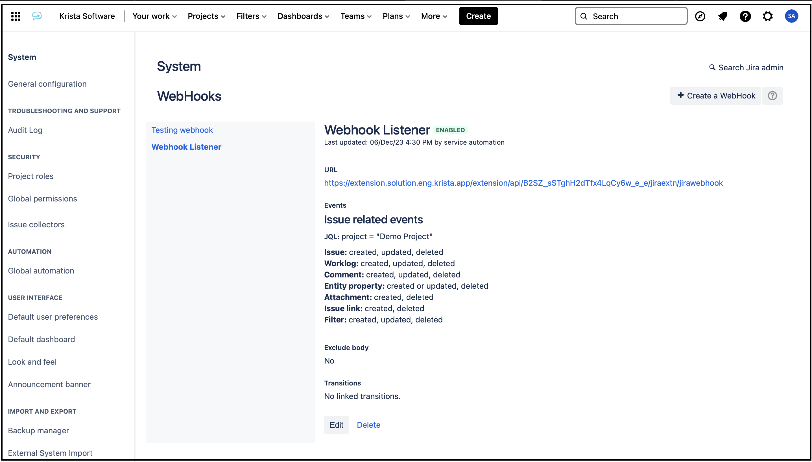
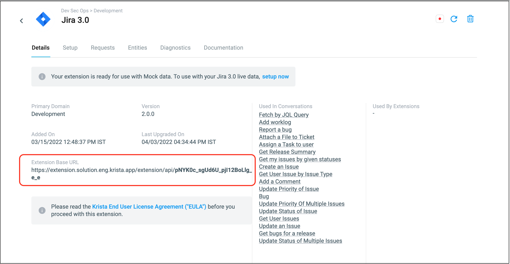
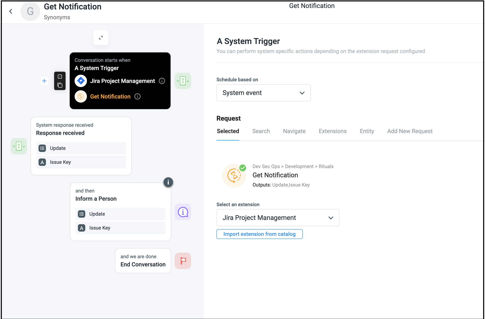

# Setting Up a Jira Webhook for Notifications

## Step 1: Verify Access Permissions

Ensure you have global admin access in Jira. This level of access is required to create and manage webhooks.

## Step 2: Access Webhook Settings in Jira

Navigate to the webhook settings in your Jira instance. You can do this in two ways:

- **Through Jira Portal:**
    - Go to the **Administrator** Settings in Jira.
    - On the bottom left, select the **Jira** option.
    - You will be redirected to a new page where you can find the webhook settings.
- **Direct URL Access:**
    - Use the direct URL to the webhook settings page: `https://your-domain/plugins/servlet/webhooks`. Replace
      `your-domain` with your actual Jira domain.
      

## Step 3: Create the Webhook

On the webhook settings page, create a new webhook:

- **Set the Webhook URL:**
    - Provide the URL where Jira will send notifications. Use the format: `Extension Base URL + "jiraextn/jirawebhook"`.
      Replace `Extension Base URL` with the base URL of your extension. 
- **Configure Webhook Events and Filters:**
    - Choose the events that will trigger the webhook, such as `jira:issue_created`, `jira:issue_updated`.
    - Optionally, set filters using JQL (Jira Query Language) to specify conditions under which the webhook should
      trigger. Example: **"Project = 'Demo Project'"**.
- **Other Settings:**
    - Configure additional settings as needed for your specific requirements.

## Step 4: Save the Webhook Configuration

After setting up the URL, events, and filters, save the webhook configuration.

## Step 5: Test and Validate

Test the webhook to ensure it's working as expected. You might want to create or update an issue in Jira that meets the
specified criteria and check if your configured URL receives the webhook notification using system trigger in
conversation. 

## Understanding Webhook Notifications

This process enables you to receive notifications tailored to your specific webhook configuration. Each notification
reflects the events and criteria defined in your webhook setup.
